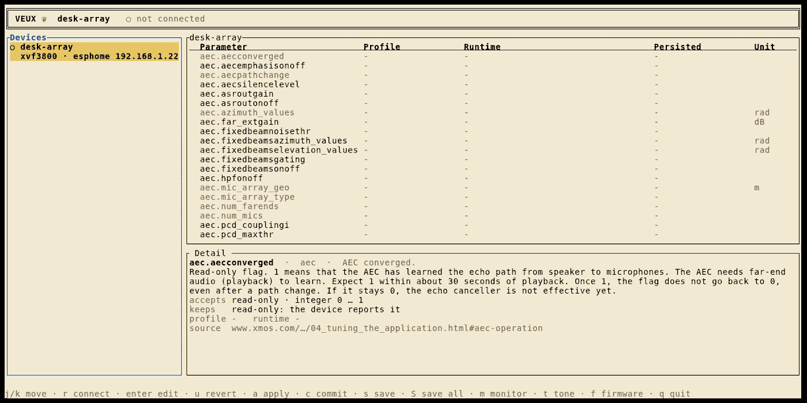

<p align="center">
  
  
</p>

# veux

A terminal UI to configure ReSpeaker audio devices across a network, with the desired
state in `veux.toml`.

**[Documentation](docs/README.md)** ·
**[Devices](docs/devices/README.md)** ·
**[Development](docs/development/README.md)**

<p align="center">
  
</p>

## How it works

`veux` reads and writes the parameters of each device through the link that the device has:
* USB vendor control
* ALSA on a remote host
* ESPHome native API

A device on a remote host is reached over SSH, and `veux` uploads a small static helper to the host and talks to it
on `stdin` and `stdout`. The schema of each device drives the TUI, and a profile in
`veux.toml` gives the desired values. `veux` shows where the device differs from the
profile, and saves tuned values back into the file.

For the diagram and the repository layout, see [`docs/architecture.md`](docs/architecture.md).

## Supported devices

To add support for a device, write a driver module in `crates/veux-drivers`. The steps are in
[`docs/devices/README.md`](docs/devices/README.md).

| Kind                                                 | Hardware                              | Links                              |
|---                                                   |---                                    |---                                 |
| [`xvf3800`](docs/devices/xvf3800.md)                 | ReSpeaker XVF3800 4-mic array         | `usb` (local or remote), `esphome` |
| [`respeaker-2mic-v1`](docs/devices/respeaker-2mic.md) | ReSpeaker 2-Mics Pi HAT v1.x (WM8960) | `alsa` (remote)                    |

## Quick start

```bash
nix develop
just release                    # cross-builds the static helpers for remote hosts and embeds them
./target/release/veux           # opens the TUI
```

Without `--config`, `veux` reads `./veux.toml`, then `~/.config/veux/veux.toml`. An
example is in [`examples/veux.toml`](examples/veux.toml).

Before the first run, check the setup:

| Need | Setup |
|---|---|
| XVF3800 on USB | Install the udev rule in [`docs/devices/xvf3800.md`](docs/devices/xvf3800.md). |
| ESPHome device | Put its API key in the environment variable that its config names. See [`docs/devices/esphome.md`](docs/devices/esphome.md). |
| ESPHome test tone | Allow TCP port 8790 on this machine. See [`docs/devices/esphome.md`](docs/devices/esphome.md). |

## The TUI

`veux` opens a device tree and a parameter table. Each parameter has three values:
the **profile** value (what `veux.toml` wants), the **runtime** value (what the device
has now), and the **persisted** value (what the device keeps after a power cycle).
A detail pane explains the highlighted parameter: what it does, what it accepts, and
how it keeps its value. The explanations cite their sources.

### Keys

| Task | Key | What it does |
|---|---|---|
| Read | `r` | Connects to the device and reads its values. |
| Edit | `enter` | Booleans and options open a list. Numbers and text open an input line with the valid range. |
| | `u` | Sets the highlighted value back to the profile value. |
| Save to profile | `s` | Saves the highlighted value into the device profile in `veux.toml`. |
| | `S` | Saves all edits. The save keeps the comments and layout of the file. |
| Apply | `a` | Writes the whole profile to the runtime of the device. Asks first. |
| Persist | `c` | Makes the runtime values survive a power cycle. Asks first. |
| Monitor | `m` | Shows live microphone levels in place of the detail pane. The XVF3800 also shows direction and speech. |
| Test | `t` | Plays a 440 Hz tone on the left, right, or both channels. Works on the 2-Mic HAT and on an ESPHome media player. |
| Firmware | `f` | Shows the firmware version and DFU slots. |
| | `F` | Flashes an image after a confirmation that shows its size and sha256. |
| Quit | `q` | Asks first when edits are not saved. |

Edits write runtime values only. Nothing reaches flash or `asound.state` until you
persist. On the 2-Mic HAT, the Persisted column shows what the card restores at boot.

### Theme

The default theme, `ligne-claire`, is ink on cream paper in a 1930s comic style.
`--theme plain` uses the terminal colours.

## Command line

Every command takes `--config`. Device names come from `veux.toml`.

### Check a config

```bash
veux check --config examples/veux.toml   # checks a config against the device schemas
veux plan                                # shows where devices differ from their profiles
```

### Apply a profile

```bash
veux apply kitchen-hat    # writes profile values to the runtime
veux commit kitchen-hat   # makes the runtime values survive a power cycle
veux export kitchen-hat   # prints the runtime values as a profile table
```

### Read and write values

```bash
veux read desk-array number.asr_output_gain
veux write desk-array switch.wake_sound=false   # runtime only, in TOML syntax
```

### Monitor and test

```bash
veux meter kitchen-hat                   # shows live levels for 10 s
veux tone kitchen-hat --channel right    # plays a test tone on one channel
```

### Update firmware

```bash
veux firmware office-array               # shows the version and DFU slots
veux firmware office-array image.bin     # flashes an image after a confirmation
veux firmware desk-array --bundled       # ESPHome: the ESP32 writes the image of its build
```

### Find devices

```bash
veux probe    # finds XVF3800 devices on local USB
```

## Contributing

Changes come from forks. See [CONTRIBUTING.md](CONTRIBUTING.md).

## License

MIT. See [LICENSE](LICENSE).
