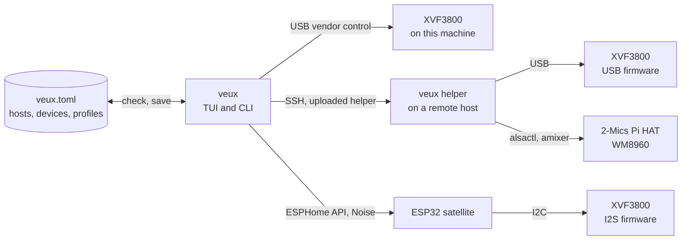

# Architecture

`veux` is one binary that reads and writes device parameters through three links: local USB,
SSH with an uploaded helper, and the ESPHome API. The model crate holds the schema and the
`veux.toml` profiles. The drivers crate opens each device. The RPC crate carries the driver
calls to a remote host. The binary joins them in the CLI and the TUI.

For the full design, see [spec.md](spec.md).

## Repository layout

| Path | Contents |
|---|---|
| [`crates/veux-model/`](../crates/veux-model) | Schema, values, `veux.toml`, validation, and the three-state diff |
| [`crates/veux-drivers/`](../crates/veux-drivers) | The `Device` trait, one module for each kind, the ESPHome client, and DFU |
| [`crates/veux-drivers/src/explanations/`](../crates/veux-drivers/src/explanations) | Sourced explanations of each parameter |
| [`crates/veux-rpc/`](../crates/veux-rpc) | The helper protocol: messages, server loop, and remote devices |
| [`crates/veux/`](../crates/veux) | The binary: CLI, TUI, SSH transport, and `helper` mode |
| [`examples/veux.toml`](../examples/veux.toml) | An example inventory with profiles |
| [`docs/`](.) | Design and device documentation |
